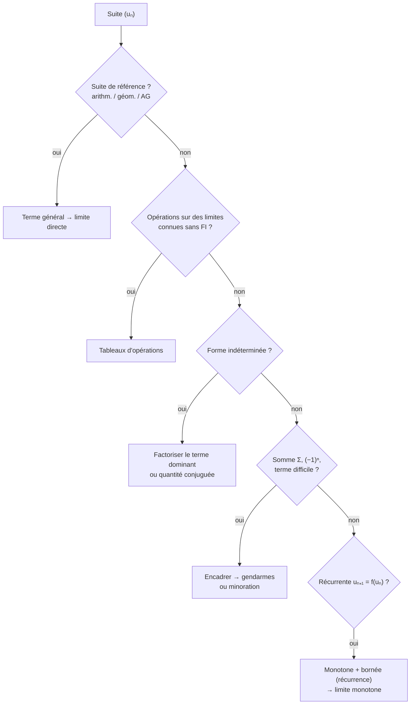

# Chapitre 4 · Suites réelles

> Mathématiques 1 · N. Blacher · TSE
>
> **Format : définitions (D) et théorèmes (T) numérotés pour pouvoir les citer, tableaux d'opérations, et organigramme final « comment trouver une limite ».** 💡 = intuition (ajout hors slides).

**Sommaire** : [1. Définir une suite](#1-définir-une-suite) · [2. Suites de référence](#2-suites-de-référence) · [3. Variations et bornes](#3-sens-de-variation-et-bornes) · [4. Valeur absolue](#4-valeur-absolue-rappel) · [5. Limites](#5-limites) · [6. Opérations](#6-opérations-sur-les-limites) · [Organigramme](#-organigramme--trouver-une-limite)

---

## 1. Définir une suite

> [!NOTE]
> **D1 · Suite.** Collection indexée de réels $(u_n)_{n\in\mathbb N}=(u_0,u_1,u_2,\dots)$. L'ensemble des suites réelles est $\mathbb R^{\mathbb N}$.
> - **Explicite** : on donne $u_n$ en fonction de $n$ (ex. $u_n=\pi^n$).
> - **Par récurrence** : on donne $u_0$ et $u_{n+1}=f(u_n)$.

> [!CAUTION]
> - $(u_n)_{n\in\mathbb N}\in\mathbb R^{\mathbb N}$ (la suite) mais $u_n\in\mathbb R$ (un terme).
> - Une suite peut commencer à un rang $k$ : $(u_n)_{n\geq k}$.
> - $u_0=1$, $u_{n+1}=\ln(u_n)$ : $u_1=0$ et $u_2$ n'existe pas (hors du domaine de $\ln$).

---

## 2. Suites de référence

| Type | Récurrence | Terme général |
|---|---|---|
| Arithmétique (raison $a$) | $u_{n+1}=u_n+a$ | $u_m=u_0+ma$ |
| Géométrique (raison $b$) | $u_{n+1}=b\,u_n$ | $u_m=u_0\,b^m$ |
| Arithmético-géométrique ($a\neq 1$) | $u_{n+1}=a\,u_n+b$ | $u_m=a^m(u_0-r)+r$, avec $r=\dfrac{b}{1-a}$ (point fixe) |

> [!TIP]
> 💡 **D'où vient la formule AG.** Le point fixe vérifie $r=ar+b$. L'écart $v_n=u_n-r$ vérifie $v_{n+1}=a\,v_n$ : il est **géométrique**. Donc $u_m-r=a^m(u_0-r)$. Si $|a|<1$, $u_n\to r$.

---

## 3. Sens de variation et bornes

> [!NOTE]
> **D2 · Monotonie.** $(u_n)$ est **croissante** si $\forall n,\ u_{n+1}\geq u_n$ (**strictement** avec $>$), **décroissante** si $u_{n+1}\leq u_n$ (strict. avec $<$), **monotone** si croissante ou décroissante.

> [!IMPORTANT]
> **T1 · Tests de monotonie**
> - Si $f$ est (strictement) croissante sur $\mathbb R_+$, alors $u_n=f(n)$ l'est aussi. ⚠️ Faux pour $u_{n+1}=f(u_n)$.
> - Si $\forall n,\ u_n>0$ : croissante $\iff \forall n,\ \dfrac{u_{n+1}}{u_n}\geq 1$ (strict. : $>1$ ; décroissante : $\leq 1$ ; strict. : $<1$).

> [!NOTE]
> **D3 · Bornes.** **Majorée** : $\exists M\in\mathbb R,\ \forall n,\ u_n\leq M$. **Minorée** : $\exists m,\ \forall n,\ u_n\geq m$. **Bornée** : les deux.
>
> **D4 · À partir d'un certain rang (APCR)** : il existe $N$ tel que $(u_n)_{n\geq N}$ vérifie la propriété.
> Majorée APCR ⇒ majorée (seulement un nombre fini de termes avant $N$) ; croissante APCR ⇏ croissante.

✏️ Ex. 6 — sens de variation de $v_n=\frac{n!}{n^n}$

$$\frac{v_{n+1}}{v_n}=\frac{(n+1)!}{(n+1)^{n+1}}\cdot\frac{n^n}{n!}=\left(\frac{n}{n+1}\right)^n<1$$

donc $(v_n)$ est strictement décroissante.

---

## 4. Valeur absolue (rappel)

> [!NOTE]
> **D5.** $|x|=x$ si $x\geq 0$, $-x$ sinon. $|x|=\max(x,-x)=\sqrt{x^2}$, $|x|=|-x|$, $|x|=0\iff x=0$.
> - $|x-y|$ = **distance** entre $x$ et $y$ : $|x-y|<\varepsilon\iff y-\varepsilon<x<y+\varepsilon$.
> - **Inégalité triangulaire** : $|x+y|\leq|x|+|y|$.

---

## 5. Limites

> [!NOTE]
> **D6 · Convergence.** $u_n\to\ell$ si
> $$\forall\varepsilon>0,\ \exists N_\varepsilon\in\mathbb N,\ \forall n\geq N_\varepsilon,\ |u_n-\ell|<\varepsilon$$
> **D7 · Limite infinie.** $u_n\to+\infty$ si $\forall M\in\mathbb R,\ \exists N_M,\ \forall n\geq N_M,\ u_n>M$ (pour $-\infty$ : $u_n<m$).
> **Divergente** = non convergente : tend vers $\pm\infty$, ou n'a pas de limite (ex. $(-2)^n$).

> [!TIP]
> 💡 **La définition avec ε est un défi.** L'adversaire fixe une tolérance $\varepsilon$ aussi petite qu'il veut ; tu dois trouver un rang $N$ à partir duquel **tous** les termes restent dans le couloir $]\ell-\varepsilon,\ell+\varepsilon[$. Plus $\varepsilon$ est petit, plus $N$ est grand.
> *Ex.* $\frac1n\to 0$ : on prend $N>\frac1\varepsilon$ ; pour $n\geq N$, $\frac1n\leq\frac1N<\varepsilon$.

> [!IMPORTANT]
> **T2 · Passage à la limite.** Si $u_n\geq v_n$ APCR et les deux convergent, alors $\lim u_n\geq\lim v_n$.
> ⚠️ Les inégalités **strictes deviennent larges** : $\frac1n>0$ mais $\lim\frac1n=0$.

> [!IMPORTANT]
> **T3 · Gendarmes.** Si $m_n\leq u_n\leq M_n$ APCR et $m_n\to\ell$, $M_n\to\ell$, alors $u_n\to\ell$.
>
> **T4 · Minoration / majoration.** $a_n\leq b_n$ APCR et $a_n\to+\infty$ ⇒ $b_n\to+\infty$. $v_n\leq u_n$ APCR et $u_n\to-\infty$ ⇒ $v_n\to-\infty$.
>
> **T5 · Limite monotone.** Croissante non majorée → $+\infty$ ; croissante majorée par $M$ → converge, limite $\leq M$. Symétrique pour une suite décroissante.
> ⇒ **Toute suite monotone et bornée converge.**

> [!TIP]
> 💡 **Gendarmes** : deux gendarmes marchent vers le même poste en encadrant un prisonnier, il y arrive aussi. On cherche un minorant et un majorant **simples** de $u_n$ de même limite (dans une somme : remplacer $i$ par sa plus petite / plus grande valeur).
>
> 💡 **Croissances comparées** : $\ln n\ll n^a\ll b^n\ll n!\ll n^n$ ($a>0$, $b>1$). Ex. $\frac{n^{10}}{2^n}\to 0$.
>
> 💡 **Monotone + bornée** : une suite qui monte sans dépasser un plafond s'accumule sous son « plus petit plafond », le $\sup$ (ch. 5).

---

## 6. Opérations sur les limites

**Somme et produit** (FI = forme indéterminée, à étudier au cas par cas : ça ne veut pas dire « pas de limite »)

| $\lim u_n$ | $\lim v_n$ | $\lim(u_n+v_n)$ | $\lim(u_n v_n)$ |
|:-:|:-:|:-:|:-:|
| $\ell$ | $\ell'$ | $\ell+\ell'$ | $\ell\ell'$ |
| $+\infty$ | $\ell'$ ou $+\infty$ | $+\infty$ | $+\infty$ si $\ell'>0$ ; $-\infty$ si $\ell'<0$ |
| $-\infty$ | $\ell'$ ou $-\infty$ | $-\infty$ | $-\infty$ si $\ell'>0$ ; $+\infty$ si $\ell'<0$ |
| $+\infty$ | $-\infty$ | **FI** | $-\infty$ |
| $\pm\infty$ | $0$ | $\pm\infty$ | **FI** |

**Inverse**

| $\lim u_n$ | $\ell\neq 0$ | $\pm\infty$ | $0^+$ | $0^-$ | $0$ (signe variable) |
|:-:|:-:|:-:|:-:|:-:|:-:|
| $\lim \frac{1}{u_n}$ | $\frac1\ell$ | $0$ | $+\infty$ | $-\infty$ | **?** |

- $\ell^+$ : $u_n\geq\ell$ APCR ; $\ell^-$ : $u_n\leq\ell$ APCR. Il faut $u_n\neq 0$ pour définir $\frac1{u_n}$.
- **Multiplier par $\lambda$** : limite $\lambda\ell$ ; si $\lambda<0$ les infinis s'inversent ; si $\lambda=0$, limite $0$.

✏️ Exemples corrigés (Ex. 15, 23)

**Ex. 15** — $v_n=\sum_{i=1}^{n}\frac{i}{n^2+i}$. Pour $1\leq i\leq n$ : $\frac{i}{n^2+n}\leq\frac{i}{n^2+i}\leq\frac{i}{n^2+1}$. En sommant avec $\sum i=\frac{n(n+1)}2$ :

$$\frac{n(n+1)}{2(n^2+n)}=\frac12\ \leq\ v_n\ \leq\ \frac{n(n+1)}{2(n^2+1)}\to\frac12$$

donc $v_n\to\frac12$ (gendarmes).

**Ex. 23** — $a_n=\sqrt{n^2+2n}-n$ (FI $\infty-\infty$) : quantité conjuguée.

$$a_n=\frac{2n}{\sqrt{n^2+2n}+n}=\frac{2}{\sqrt{1+\frac2n}+1}\to 1$$

et comme $\sqrt{1+\frac2n}>1$, $a_n<1$ : $a_n\to 1^-$.

---

## 🧭 Organigramme · trouver une limite

---

## ✅ À retenir

- AG : $u_m=a^m(u_0-r)+r$, $r=\frac{b}{1-a}$.
- Inégalités strictes → larges à la limite.
- Gendarmes, minoration, limite monotone : les 3 théorèmes pour prouver une limite sans la calculer.
- FI : $\infty-\infty$, $0\times\infty$, $\frac{1}{0}$ sans signe.
