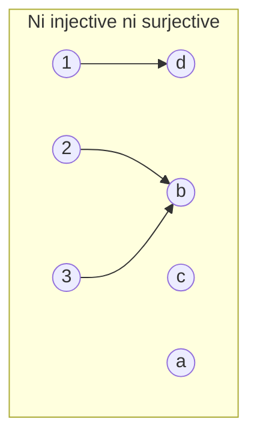
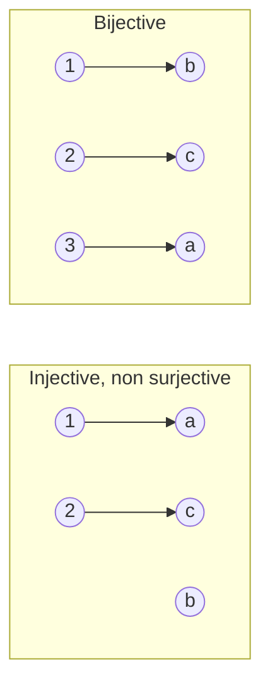

# Chapitre 6 · Fonctions (partie 1)

> Mathématiques 1 · N. Blacher · TSE
>
> **Format : méthode Cornell.** Colonne de gauche = question à se poser (cache la droite pour t'interroger), droite = réponse du cours, résumé en bas. 💡 = intuition (ajout hors slides).

| ❓ Question | 📝 Réponse |
|---|---|
| **Qu'est-ce qu'une fonction ?** | Objet qui associe à **chaque** élément de $E$ **un unique** élément de $F$. On note $f:E\to F$, $x\mapsto f(x)$. ⚠️ $f$ (la fonction) ≠ $f(x)$ (un élément de $F$). |
| **Départ, arrivée ?** | $E$ = ensemble de **départ**, $F$ = ensemble d'**arrivée**. $E\subset\mathbb R$ : fonction d'une variable réelle ; $F\subset\mathbb R$ : fonction réelle. |
| **Domaine de définition ?** | $D_g$ = réels $x$ pour lesquels $g(x)$ est défini. $D_{\exp(2x)}=\mathbb R$, $D_{\ln}=]0,+\infty[$, $D_{1/\sqrt{x^2}}=\mathbb R^*$, $D_{\sqrt{-x}}=]-\infty,0]$. |
| **Graphe ?** | $\lbrace (x,f(x)) : x\in E\rbrace\subset E\times F$. Pour une fonction réelle d'une variable réelle, c'est une partie du plan $\mathbb R^2$. |
| **Image, antécédent ?** | Si $y=f(x)$ : $y$ est **l'**image de $x$ (unique) ; $x$ est **un** antécédent de $y$ (il peut y en avoir 0, 1 ou plusieurs). |
| **Identité ?** | $\mathrm{Id}_A : A\to A$, $x\mapsto x$. |
| **Injective ?** | Tout $y\in F$ a **au plus un** antécédent. ⇔ $f(x)=f(y)\Rightarrow x=y$ ⇔ $x\neq y\Rightarrow f(x)\neq f(y)$. |
| **Surjective ?** | Tout $y\in F$ a **au moins un** antécédent : $\forall y\in F,\ \exists x\in E,\ f(x)=y$. |
| **Bijective ?** | Injective **et** surjective : $\forall y\in F,\ \exists!\,x\in E,\ f(x)=y$. |
| **Image directe ?** | Pour $A\subset E$ : $f(A)=\lbrace y\in F : \exists x\in A,\ f(x)=y\rbrace$ (toutes les images des points de $A$). |
| **Image réciproque ?** | Pour $B\subset F$ : $f^{-1}(B)=\lbrace x\in E : f(x)\in B\rbrace$. ⚠️ Existe même si $f$ n'est pas bijective. |
| 💡 **Comment le vérifier en pratique ?** | **Injective** : supposer $f(x)=f(y)$, montrer $x=y$. Sinon : deux points distincts de même image. **Surjective** : fixer $y\in F$ et **résoudre** $f(x)=y$ avec $x\in E$. Sinon : un $y$ sans antécédent. **Graphiquement** : chaque droite horizontale $y=c$ ($c\in F$) coupe le graphe au plus une fois (injective), au moins une fois (surjective), exactement une fois (bijective). |
| 💡 **Un exemple concret ?** | $f$ = « date d'anniversaire » de {étudiants} vers {jours de l'année}. C'est une fonction (une seule date par personne). Injective = personne ne partage d'anniversaire ; surjective = chaque jour est l'anniversaire de quelqu'un. Avec 270 étudiants pour 365 jours, elle ne peut **pas** être surjective. Si $\mathrm{Card}E>\mathrm{Card}F$, elle ne peut pas être injective. |
| 💡 **$f^{-1}(B)$ sans bijection ?** | Se lit « **qui est envoyé dans $B$ ?** » : on rassemble tous les antécédents. $f(x)=x^2$ : $f^{-1}(\lbrace 4\rbrace)=\lbrace -2,2\rbrace$, $f^{-1}(\lbrace -1\rbrace)=\varnothing$. Ce n'est une « fonction réciproque » que si $f$ est bijective. |

---

## Schémas sagittaux

---

✏️ Exemples corrigés (Ex. 8 à 10)

| Fonction | Injective | Surjective | Raison |
|---|:-:|:-:|---|
| $f:\mathbb R\to\mathbb R_+$, $x^2$ | ❌ | ✅ | $f(-1)=f(1)$ |
| $g:\mathbb R_+\to\mathbb R$, $x^2$ | ✅ | ❌ | $-1$ n'a pas d'antécédent |
| $\mathbb R^*\to\mathbb R$, $\frac1x$ | ✅ | ❌ | $0$ n'a pas d'antécédent |
| $\mathbb Z\to\mathbb Z$, $x^3$ | ✅ | ❌ | $2$ n'est pas un cube |
| villes → pays | ❌ | ✅ | plusieurs villes par pays |
| capitales → pays | ✅ | ✅ | bijective |

→ **Les ensembles de départ et d'arrivée changent tout** ($x^2$ dans les deux premières lignes).

**Pizzeria (Ex. 10)** — $C(n)=n\left(15-\frac{n}{100}\right)$.
- $C^{-1}(\mathbb R_-)=\lbrace 0\rbrace\cup\lbrace n\geq 1500\rbrace$ : les quantités qui ne rapportent rien ou font perdre de l'argent.
- $C(\lbrace 100,\dots,1000\rbrace)$ : les chiffres d'affaires possibles en vendant entre 100 et 1000 pizzas.

---

> [!IMPORTANT]
> **📌 Résumé.** Une fonction donne une **unique image** à chaque élément de départ. **Injective** = au plus un antécédent, **surjective** = au moins un, **bijective** = exactement un. Ces propriétés dépendent des ensembles de départ et d'arrivée. $f(A)$ = ensemble des images de $A$ ; $f^{-1}(B)$ = ensemble des points envoyés dans $B$.
