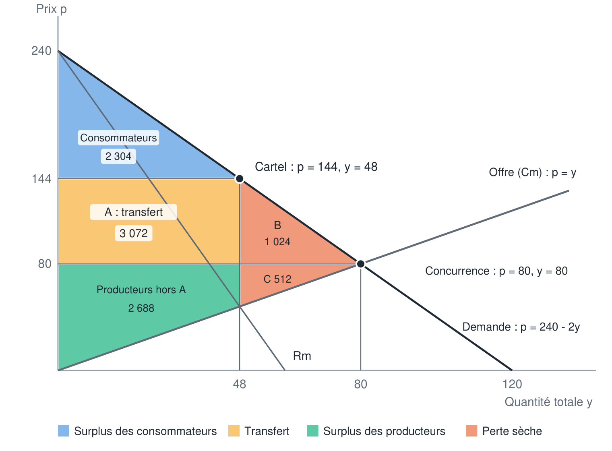

# Micro — Le duopole : cartel, équilibre de Nash et lutte contre les ententes

## Définitions

- **Économie industrielle** : branche de l'économie qui étudie le fonctionnement des marchés et le comportement des entreprises sur ces marchés, notamment quand elles disposent d'un pouvoir de marché (concurrence imparfaite). Elle évalue aussi la performance des marchés (efficacité, bien-être collectif) et sert d'aide à la décision publique pour la régulation des marchés. C'est le thème de recherche principal de TSE (Jean Tirole, prix Nobel 2014).
- **Concurrence imparfaite** : situation où les entreprises disposent d'un pouvoir de marché (monopole, duopole, oligopole).
- **Duopole** : marché sur lequel deux entreprises seulement se font concurrence en produisant le même bien.
- **Duopole asymétrique** : duopole dont les deux entreprises ont des fonctions de coût différentes.
- **Bien homogène** : bien identique quel que soit le producteur ; les consommateurs n'ont aucune préférence pour l'un ou l'autre vendeur.
- **Cartel (entente)** : accord entre entreprises concurrentes pour coordonner leurs décisions (quantités, prix, parts de marché) ; un cartel se comporte comme un monopole.
- **Solution coopérative** : situation où les entreprises s'entendent pour maximiser leur profit **global** (solution du cartel).
- **Quota** : quantité que le cartel attribue à chacun de ses membres.
- **Coûts convexes / rendements décroissants** : le coût marginal est croissant ; produire une unité de plus coûte de plus en plus cher.
- **Meilleure réponse** : quantité qui maximise le profit d'une entreprise compte tenu de la quantité produite par l'autre.
- **Fonction de meilleure réponse** : fonction qui donne la meilleure réponse d'une entreprise pour chaque quantité possible de l'autre, obtenue en annulant la dérivée de son profit par rapport à sa propre quantité.
- **Équilibre de Nash (du duopole)** : couple de quantités tel que chaque entreprise produit sa meilleure réponse à la quantité de l'autre ; aucune n'a intérêt à dévier seule.
- **Programme de clémence** : dispositif des autorités de la concurrence qui accorde une réduction ou une immunité d'amende à l'entreprise qui dénonce un cartel auquel elle participe.
- **Paiement compensatoire (transfert)** : somme versée par une entreprise à une autre pour qu'elle accepte la solution du cartel quand celle-ci lui est défavorable.

## 1. Introduction : du monopole au duopole

Le chapitre 2 a montré comment se comporte une entreprise qui produit un bien différencié, donc en monopole sur son produit. On analyse maintenant une situation de **concurrence imparfaite** à deux entreprises : le **duopole**.

Ce type d'analyse relève de l'**économie industrielle**. Son intérêt pratique : évaluer si un marché fonctionne bien pour la collectivité, et éclairer la régulation (autorités de la concurrence).

## 2. La situation : deux foodtrucks

### 2.1 L'offre

Deux foodtrucks, **Burger & Co** (B&C) et **Teddy Burger** (TB), vendent le même bien (des burgers) et sont situés l'un près de l'autre. Une étude de marché indique :

- ils ont la **même technologie**, donc les **mêmes coûts** ;
- coût total de chaque entreprise : $C(q) = q^2$ ;
- coût marginal : $Cm(q) = 2q$ (croissant : coûts convexes, rendements décroissants).

### 2.2 La demande

- Les consommateurs n'ont **aucune préférence** pour l'un ou l'autre (bien homogène).
- Plus les burgers sont chers, moins il s'en vend : pour écouler beaucoup, il faut baisser le prix.
- Demande totale, avec $y$ la quantité totale et $p$ le prix :

$$y = 120 - \frac{p}{2} \qquad \Longleftrightarrow \qquad p = 240 - 2y$$

Avec deux entreprises, la quantité totale est $y = q_1 + q_2$ : le prix dépend donc de ce que produisent **les deux**.

## 3. La solution coopérative : le cartel

### 3.1 Répartir la production

Supposons que les deux entreprises s'entendent pour former un **cartel** : elles se comportent alors comme un **monopole** qui doit décider combien chaque entreprise produit.

Comme les rendements sont décroissants dans chaque entreprise (coûts convexes), il est optimal de **répartir la production équitablement** : faire produire davantage à l'une la ferait monter sur une partie plus chère de son coût marginal.

Si $y$ est la production totale, chaque entreprise produit $y/2$, et le coût du cartel est :

$$C(y) = 2 \times \left(\frac{y}{2}\right)^2 = \frac{y^2}{2} \qquad \Rightarrow \qquad Cm(y) = y$$

### 3.2 Résolution

Le cartel maximise son profit comme un monopole, là où $Rm = Cm$ :

$$R(y) = (240 - 2y)\ y = 240y - 2y^2 \qquad Rm(y) = 240 - 4y$$

$$240 - 4y = y \quad \Rightarrow \quad y = 48$$

- chaque foodtruck produit $48 / 2 = 24$ burgers ;
- prix : $p = 240 - 2 \times 48 = 144$ ;
- profit du cartel : $\Pi = 48 \times 144 - 48^2 = 5\ 760$, soit **2 880 par entreprise**.

Le tableau des profits globaux (somme des deux profits selon les quantités de chacun) confirme que la répartition 24 / 24 donne le profit global le plus élevé possible (5 760).

## 4. L'entente est-elle tenable ?

### 4.1 Le profit de chaque entreprise dépend de l'autre

Coopérer en produisant 24 chacun est la meilleure solution **collective**. Mais chaque entreprise peut être tentée de **tricher** : accepter l'entente (produire 24) puis produire une autre quantité pour gagner plus.

Chacune choisit la quantité (sans invendus) qui maximise son propre profit :

$$\Pi_{BC} = p\ q_{BC} - C(q_{BC}) = \big(240 - 2(q_{BC} + q_{TB})\big)\ q_{BC} - q_{BC}^2$$

$$\Pi_{TB} = \big(240 - 2(q_{BC} + q_{TB})\big)\ q_{TB} - q_{TB}^2$$

Si l'une des entreprises produit beaucoup, le prix baisse **pour tout le monde** (et inversement) : le profit de l'une dépend des décisions de l'autre. C'est exactement le type de problème que résout la **théorie des jeux** (chapitre 1).

### 4.2 Le jeu sous forme normale

Chaque entreprise choisit sa quantité parmi 18, 24, 30, 36. Profits (B&C ; TB) :

| B&C \ TB | 18 | 24 | 30 | 36 |
|---|---|---|---|---|
| **18** | 2 700 ; 2 700 | 2 484 ; 3 168 | 2 268 ; 3 420 | 2 052 ; 3 456 |
| **24** | 3 168 ; 2 484 | 2 880 ; 2 880 | 2 592 ; 3 060 | 2 304 ; 3 024 |
| **30** | 3 420 ; 2 268 | 3 060 ; 2 592 | **2 700 ; 2 700** | 2 340 ; 2 592 |
| **36** | 3 456 ; 2 052 | 3 024 ; 2 304 | 2 592 ; 2 340 | 2 160 ; 2 160 |

### 4.3 L'instabilité du cartel

Si TB respecte son quota (24), la meilleure réponse de B&C est de produire **30** : son profit passe de 2 880 à 3 060, tandis que celui de TB tombe à 2 592. Le problème est symétrique pour TB.

Chacun a intérêt à produire plus que son quota pour **profiter du prix élevé obtenu grâce à la réduction de production de l'autre**. La solution du cartel **n'est donc pas un équilibre de Nash**.

```
Cartel (24 ; 24) → B&C triche et produit 30 → B&C gagne (3 060), TB perd (2 592)
                 → TB fait de même → (30 ; 30) : chacun gagne 2 700 < 2 880
```

### 4.4 Meilleures réponses et équilibre de Nash

Dans la matrice, on souligne pour chaque quantité de l'autre la meilleure réponse de chaque entreprise (méthode du chapitre 1). La seule case où les deux meilleures réponses se croisent est **(30 ; 30)**.

Vérification par le calcul : si l'autre entreprise produit 30, une entreprise maximise

$$\Pi(q) = \big(240 - 2(30 + q)\big)\ q - q^2 = 180q - 3q^2$$

$$\Pi'(q) = 180 - 6q = 0 \quad \Rightarrow \quad q = 30$$

30 est bien la meilleure réponse à 30 : **(30 ; 30) est l'équilibre de Nash**.

**Fonction de meilleure réponse (cas général)** : en dérivant $\Pi_1 = (240 - 2q_1 - 2q_2)\ q_1 - q_1^2$ par rapport à $q_1$ :

$$240 - 6q_1 - 2q_2 = 0 \quad \Rightarrow \quad q_1 = 40 - \frac{q_2}{3}$$

Les entreprises étant identiques, l'équilibre est symétrique ($q_1 = q_2 = q$) : $q = 40 - q/3$, d'où $q = 30$. (Avec cette fonction, la meilleure réponse exacte à 24 est 32 ; parmi les seules quantités du tableau, c'est 30.)

À l'équilibre de Nash :

- production totale : 60 ;
- prix : $p = 240 - 2 \times 60 = 120$ (contre 144 avec le cartel) ;
- profit de chaque entreprise : $120 \times 30 - 30^2 = 2\ 700$ (contre 2 880).

### 4.5 Méthode générale pour résoudre un duopole

1. Écrire la demande inverse $p(y)$ avec $y = q_1 + q_2$.
2. Écrire le profit de chaque entreprise : $\Pi_i = p(q_1 + q_2)\ q_i - C_i(q_i)$.
3. Dériver $\Pi_i$ par rapport à $q_i$ (l'autre quantité est considérée comme donnée) et annuler : on obtient la **fonction de meilleure réponse** de chaque entreprise.
4. Résoudre le système des deux meilleures réponses (si les entreprises sont identiques, poser $q_1 = q_2$) : c'est l'**équilibre de Nash**.
5. En déduire le prix (demande inverse) puis les profits.

L'arrivée d'une seconde entreprise ne change **pas la fonction de demande** : c'est un changement du côté de l'offre, qui n'a aucun effet sur le comportement des consommateurs.

## 5. Comparaison cartel / duopole / concurrence

### 5.1 Cartel contre duopole

| | Cartel | Duopole (Nash) |
|---|---|---|
| Quantité par entreprise | 24 | 30 |
| Quantité totale | 48 | 60 |
| Prix | 144 | 120 |
| Profit par entreprise | 2 880 | 2 700 |

- Avec un cartel, les **profits sont plus élevés**, l'**offre plus faible** et le **prix plus élevé**.
- Mais le cartel est **instable** : chaque membre a intérêt à produire plus que son quota. C'est un **dilemme du prisonnier**.
- Les cartels peuvent tenter d'empêcher les déviations : menaces de rétorsion, comportements mafieux…
- Comme les monopoles (chapitre 2), les cartels sont **incompatibles avec le bien commun** : en produisant plus, on augmenterait le bien-être.

### 5.2 Ajouter la concurrence

Si chaque entreprise prend le prix comme donné (concurrence, chapitre 4), elle produit là où $p = Cm(q) = 2q$, soit $q = p/2$. L'offre globale des deux entreprises est $y = p$ ; l'égaliser à la demande $y = 120 - p/2$ donne $p = 80$, $y = 80$ et $q_1 = q_2 = 40$.

| | Monopole (cartel) | Duopole | Concurrence |
|---|---|---|---|
| Quantité totale | 48 | 60 | 80 |
| Prix | 144 | 120 | 80 |
| Profit par entreprise | 2 880 | 2 700 | 1 600 |
| Surplus des consommateurs | 2 304 | 3 600 | 6 400 |
| Surplus des producteurs (total) | 5 760 | 5 400 | 3 200 |
| Surplus total | 8 064 | 9 000 | 9 600 |



Les surplus des consommateurs se calculent comme l'aire du triangle sous la demande et au-dessus du prix, $\frac{1}{2}(240 - p)\ y$. Par exemple, un consommateur qui valorise le bien à 240 et le paie 144 obtient un surplus de 96 ; celui qui le valorise à 150 obtient 6.

```
Plus de concurrence → quantité ↑, prix ↓, profit individuel ↓
                    → surplus des consommateurs ↑, surplus des producteurs ↓, surplus total ↑
```

## 6. Prévenir et combattre les cartels

### 6.1 Pourquoi les cartels sont illégaux

Les cartels sont le plus souvent **illégaux**, car ils se font au détriment de la concurrence et donc des consommateurs : moins de biens vendus, à un prix plus élevé.

### 6.2 Les programmes de clémence

Mis en place par les autorités de la concurrence, ils récompensent l'entreprise qui **dénonce** un cartel. C'est le moyen le plus efficace pour lutter contre les cartels :

- ils **augmentent encore le bénéfice à dévier** plutôt qu'à coopérer (ils renforcent le dilemme du prisonnier) ;
- ils **facilitent la condamnation** des cartels détectés (preuves juridiques) ;
- ils **accentuent l'instabilité** des cartels non détectés ;
- ils **découragent la formation** de nouveaux cartels.

Exemples en Europe :

| Cartel | Faits | Sanction | Dénonciateur épargné |
|---|---|---|---|
| Lessives (France, 1997-2004) | Entente sur les prix entre Ariel, Skip, Le Chat, Omo, Super Croix, Gama, Persil et X-Tra | 250 M€ | Unilever, qui a dénoncé la pratique |
| Fret aérien (Europe, 2010) | Onze transporteurs se concertent sur les taxes carburant et sécurité | 799 M€, dont 340 M€ pour Air France-KLM | Lufthansa (immunité totale, première à fournir des informations) |
| Écrans LCD (Europe, 2011) | Entente sur les prix entre six producteurs, dont Samsung et LG | 648 M€ | Samsung (première à fournir des informations) |

Limites de la clémence :

- son efficacité pour démanteler les ententes est **incontestable** ;
- mais récompenser un ancien « criminel » pose des **questions morales** ;
- le dénonciateur peut l'**instrumentaliser** pour conforter sa position sur le marché et déstabiliser, voire éliminer, ses concurrents.

### 6.3 Les enquêtes

Certains cartels sont démantelés sans dénonciation, à la suite d'une **enquête** :

- **téléphonie mobile (2005)** : entente sur les parts de marché entre Orange, Bouygues et SFR ; sanction de 534 M€. L'affaire a légitimé l'arrivée d'un quatrième opérateur ;
- **commissions interbancaires sur les chèques (2010)** : entente entre la Banque Postale, BNP, Crédit Mutuel, Crédit Agricole, Société Générale, HSBC… ; sanction de 384 M€.

## 7. Application : le duopole asymétrique

Deux entreprises produisent un bien homogène avec des coûts **différents** : $C_1(q_1) = \frac{1}{2}q_1^2$ et $C_2(q_2) = 5q_2$. Demande : $Q(p) = 200 - 2p$, avec $Q = q_1 + q_2$.

**Profit par unité et profit total** : le profit par unité est la marge $p - CM$ ; le profit total est $\Pi = p\ q - C(q)$, soit la marge multipliée par la quantité.

**Demande inverse** : $p = 100 - \dfrac{q_1 + q_2}{2}$.

**Profits** :

$$\Pi_1 = \left(100 - \frac{q_1 + q_2}{2}\right) q_1 - \frac{1}{2}q_1^2 \qquad \Pi_2 = \left(100 - \frac{q_1 + q_2}{2}\right) q_2 - 5q_2$$

**Meilleures réponses** (dérivée par rapport à sa propre quantité, égale à 0) :

$$q_1 = 50 - \frac{q_2}{4} \qquad q_2 = 95 - \frac{q_1}{2}$$

**Équilibre de Nash** : $q_1 = 30$, $q_2 = 80$, prix $p = 45$ ; profits $\Pi_1 = 900$ et $\Pi_2 = 3\ 200$ (total 4 100). On retrouve ces valeurs comme case où les meilleures réponses se croisent dans les tableaux de profits.

**L'équilibre de Nash n'est pas le meilleur résultat possible** : le profit global est maximal en faisant produire davantage l'entreprise la moins coûteuse à la marge. En maximisant la somme des profits ($100 - Q - q_1 = 0$ et $100 - Q - 5 = 0$), on obtient $Q = 95$, $q_1 = 5$, $q_2 = 90$, $p = 52{,}5$, et un profit global d'environ 4 525 ($\Pi_1 = 250$, $\Pi_2 = 4\ 275$).

**La firme 1 accepterait-elle ce cartel ?** Non, pas sans compensation : elle y gagnerait 250 au lieu de 900. La firme 2, elle, passe de 3 200 à 4 275 : elle peut **verser un paiement compensatoire** (transfert) à la firme 1, compris entre 650 et 1 075, pour que les deux y gagnent.

**Problème soulevé** : ce transfert est la preuve d'une entente, **illégale** et détectable par les autorités de la concurrence ; et le cartel reste instable, chaque firme ayant toujours intérêt à dévier de son quota.

<!-- SOURCES INTÉGRÉES
- Chapitre 3 - Le Duopole ✅.pdf
- Exemple Monopole duopole concurrence Gollier ✅.pdf
- TD3 ✅.pdf
- CC2 - Correction Succincte ✅.pdf
-->
