# Micro — Offre et demande : l'équilibre concurrentiel

## Définitions

### Concurrence pure et parfaite

- **Concurrence pure et parfaite (CPP)** : situation théorique où une multitude de producteurs et d'acheteurs échangent un bien homogène, avec information parfaite et libre entrée ; aucun agent n'a de pouvoir de marché.
- **Preneur de prix** : agent qui ne peut pas influencer le prix de marché et le prend comme donné ; il ne choisit que sa quantité.
- **Homogénéité du bien** : tous les vendeurs proposent exactement le même bien ; le prix est la seule chose à regarder.
- **Atomicité des agents** : acheteurs et vendeurs sont très nombreux et assez « petits » pour n'avoir aucune influence déterminante sur le marché.
- **Information parfaite** : chacun connaît la qualité du bien et observe toutes les transactions ; pas d'asymétrie d'information.
- **Libre entrée** : absence de barrière à l'entrée ; tout le monde peut participer au marché sans coût supplémentaire à payer pour en avoir le droit.
- **Libre circulation des facteurs de production** : le capital et le travail peuvent se déplacer librement vers les activités où ils sont demandés.
- **Loi du prix unique** : sur un marché qui fonctionne bien, un seul prix se forme.

### Offre

- **Offre d'une entreprise** : quantité qu'une entreprise souhaite vendre à chaque prix ; en concurrence, c'est sa courbe de coût marginal ($Cm(q) = P$).
- **Offre agrégée** : somme, pour chaque prix, des quantités que chaque producteur souhaite vendre à ce prix.
- **Agrégation horizontale** : construction de l'offre agrégée en additionnant les quantités offertes (sur l'axe horizontal) à prix donné.

### Équilibre et bien-être

- **Équilibre concurrentiel** : situation où tous les acheteurs et vendeurs sont preneurs de prix et où, au prix en vigueur $P^*$, la quantité offerte est égale à la quantité demandée.
- **Excès d'offre** : au prix en vigueur, la quantité offerte dépasse la quantité demandée ; pression à la baisse du prix.
- **Excès de demande (pénurie)** : au prix en vigueur, la quantité demandée dépasse la quantité offerte ; pression à la hausse du prix.
- **Signal-prix** : rôle du prix d'équilibre, qui informe et incite chaque producteur et chaque consommateur sans organisation centralisée.
- **Rente (du producteur)** : profit positif obtenu par un producteur dont le coût est inférieur au prix d'équilibre.
- **Consommateurs infra-marginaux** : consommateurs dont la propension à payer est supérieure au prix d'équilibre.
- **Acheteur marginal** : dernier acheteur servi, dont la propension à payer est égale au prix d'équilibre.
- **Surplus à l'échange (surplus total)** : somme des surplus des consommateurs et des producteurs.
- **Théorème de la main invisible** : l'équilibre concurrentiel maximise le surplus à l'échange ; il est efficace (Pareto-optimal).

### Chocs et interventions

- **Choc de demande** : modification de la courbe de demande (PIB, prix des autres biens, environnement, découverte des bienfaits d'un bien…).
- **Choc d'offre** : modification de la courbe d'offre (prix des inputs, innovation technologique…).
- **Biens substituts** : biens qui peuvent se remplacer ; quand le prix de l'un augmente, la demande de l'autre augmente (bœuf et poulet).
- **Biens compléments** : biens consommés ensemble ; quand le prix de l'un augmente, la demande de l'autre baisse (voiture et essence).
- **File d'attente** : traduction concrète d'un excès de demande ; sa longueur est la différence entre quantité demandée et quantité offerte.
- **Prix plafond** : prix maximum imposé par l'État, inférieur au prix d'équilibre (ex. contrôle des loyers).
- **Prix plancher** : prix minimum imposé par l'État, supérieur au prix d'équilibre (ex. salaire minimum).
- **Perte sèche** : surplus total perdu par rapport à l'équilibre concurrentiel, que personne ne récupère.

## 1. La concurrence pure et parfaite : simulation d'une salle de marché

### 1.1 Pourquoi étudier la concurrence ?

Après le monopole (une entreprise) et le duopole (deux entreprises), on étudie ce qui se passe quand **une multitude d'entreprises** se font concurrence face à **une multitude de consommateurs** : c'est la **concurrence pure et parfaite**.

### 1.2 Le jeu de marché

On simule une salle de marché :

- une multitude de vendeurs et d'acheteurs d'un **bien homogène** ;
- chaque vendeur ne peut vendre qu'**une unité** et chaque acheteur n'en acheter qu'**une** ;
- tous sont dans le même lieu, où ils peuvent discuter, observer et négocier.

Chaque acheteur reçoit une **propension à payer** (PAP), tirée au hasard à chaque manche : c'est le prix maximum qu'il accepte de payer. Chaque vendeur reçoit un **coût unitaire de production**, lui aussi tiré au hasard : c'est le prix minimum qu'il accepte.

Un échange n'est possible que si :

$$\text{coût du vendeur} \leq \text{prix} \leq \text{PAP de l'acheteur}$$

Les échanges se font par offres privées (entre un acheteur et un vendeur qui se sont mis d'accord) ou par offres publiques (visibles par tous). Scores :

- **acheteur** : PAP − prix négocié ;
- **vendeur** : prix négocié − coût unitaire ;
- pas d'échange : score nul.

À la fin de chaque manche, on observe les prix de tous les échanges : c'est une information précieuse pour mieux négocier ensuite. La simulation est faite **avant** la théorie pour que la façon de jouer ne soit pas influencée par les connaissances.

### 1.3 Résultats

- Au fil des manches, les **prix négociés convergent vers une seule et même valeur**.
- Le **surplus total augmente** :

$$\text{Surplus total} = \underbrace{\sum (\text{PAP} - \text{prix})}_{\text{surplus des acheteurs}} + \underbrace{\sum (\text{prix} - \text{coût})}_{\text{surplus des vendeurs}}$$

Dans une session, on a observé 27 échanges à un prix moyen de 5,6, pour un surplus total de 119 sur un potentiel de 140 : les échanges n'avaient pas encore exploité tous les gains possibles.

Résultat fondamental de la concurrence pure et parfaite :

- les agents sont **preneurs de prix** ;
- le **surplus total est maximum**.

### 1.4 Les hypothèses de la concurrence pure et parfaite

Ce résultat n'est valable que sous des **conditions très strictes**, celles de la simulation :

1. **Homogénéité du bien** : tous les vendeurs proposent le même bien ;
2. **Atomicité des agents** : acheteurs et vendeurs nombreux et trop petits pour influencer le marché ;
3. **Information parfaite** sur le bien et sur les transactions ;
4. **Libre entrée** : aucune barrière à l'entrée ;
5. **Libre circulation des facteurs de production** (absente de la simulation).

Un marché bien organisé (criées, enchères…) aide : échanges observables par tous, coûts de recherche du meilleur prix faibles, pas de coûts de transaction, pas d'asymétrie d'information sur la qualité. Sur un tel marché s'applique la **loi du prix unique**.

### 1.5 Existe-t-il des marchés de concurrence pure et parfaite ?

On teste les hypothèses une à une ; dès qu'une n'est pas vérifiée, le marché n'est pas en CPP.

| Marché | Hypothèse qui pose problème |
|---|---|
| Blé | Plusieurs variétés (homogénéité imparfaite) ; la terre ne circule pas. Les autres hypothèses sont plutôt vérifiées (cours mondial observable, qualité visible, libre entrée) : c'est un marché proche de la CPP |
| Gazole | Pas d'atomicité des vendeurs : peu de vendeurs |
| Bourse (une action donnée) | Information imparfaite (cf. la crise des subprimes, où les acheteurs ignoraient la qualité réelle des dettes) ; coûts de transaction |
| Devises (ex. le dollar) | Pas d'atomicité : un vendeur (la banque centrale) a une position fortement dominante |
| Travail | Information imparfaite : l'entreprise ne connaît du candidat que son CV, alors que le candidat peut tout savoir de l'entreprise ; pas d'atomicité des demandeurs de travail dans certains bassins d'emploi (Airbus à Toulouse, la préfecture dans un département rural) |

Conclusion : la CPP est **purement théorique** ; aucun marché réel ne la vérifie entièrement. Les marchés qui s'en rapprochent le plus sont ceux des **matières premières**.

**À quoi sert-elle alors ?** Elle fournit un **point de comparaison**, comme l'hypothèse d'absence de frottements en physique : on raisonne d'abord dans un monde idéal, puis on complexifie.

## 2. Offre d'une firme et offre agrégée

### 2.1 En concurrence, les prix s'imposent à tous

La concurrence **annihile la possibilité de négocier** sur les prix : personne n'a de pouvoir de marché. Si le prix de marché est $P^*$ :

- les producteurs voudraient vendre à un prix $P > P^*$, mais ils ne trouveront pas d'acheteur (les acheteurs savent qu'ils peuvent acheter à $P^*$) ;
- les consommateurs voudraient acheter à $P < P^*$, mais ne trouveront pas de vendeur (les vendeurs savent qu'ils peuvent vendre à $P^*$).

Les seuls échanges possibles se font au prix $P^*$, que chacun prend comme donné.

### 2.2 Offre d'une entreprise : prix = coût marginal

Dans le jeu, un producteur de coût $c_i$ offre son unité si et seulement si le prix est supérieur à $c_i$ : son offre est un palier (0 sous $c_i$, 1 au-dessus).

En général, l'entreprise $i$ a une fonction de coût total $C_i(q_i)$ et fait face à un prix $P^*$ qu'elle ne choisit pas. Elle choisit la quantité qui maximise son profit :

$$\max_{q_i}\; P^* q_i - C_i(q_i)$$

Condition de premier ordre : $P^* - C_i'(q_i) = 0$, soit

$$Cm_i(q_i^*) = P^*$$

En concurrence, chaque producteur choisit son volume de production de sorte que son **coût marginal soit égal au prix**. Sa courbe d'offre est donc sa courbe de coût marginal.

**Pourquoi ?**

- si $Cm < P$, produire une unité de plus rapporte $P$ et coûte moins : **accroître la production augmente le profit** ;
- si $Cm > P$, la dernière unité coûte plus qu'elle ne rapporte : **réduire la production augmente le profit**.

**Lien avec le monopole** ($Rm = Cm$) : le producteur fait le même raisonnement marginal, mais comme il est tout petit, produire plus ou moins **ne change pas le prix** : il n'y a **pas d'effet prix**, donc sa recette marginale est simplement le prix, $Rm = P$. Un boulanger qui fait 17 baguettes de plus ne change pas le prix d'équilibre de la baguette.

```
Monopole / duopole : Rm = P + effet prix (< P)  → Rm = Cm
Concurrence        : Rm = P (pas d'effet prix)  → P = Cm
```

### 2.3 Offre agrégée

Pour chaque prix $P$, l'**offre agrégée** est la somme de ce que chaque producteur désire vendre à ce prix : on additionne les courbes d'offre **horizontalement** (on somme les quantités à prix donné).

- Dans le jeu : l'offre agrégée au prix $P$ est le **nombre de producteurs dont le coût $c_i$ est inférieur à $P$** (une courbe en escalier croissante).
- **50 boulangers identiques** : si chacun offre 100 pains à 2 €, l'offre agrégée à 2 € est de 5 000 pains (l'axe des quantités est multiplié par 50).
- **Courbe d'offre d'EDF** : les moyens de production sont classés par coût marginal croissant (hydraulique et nucléaire d'abord, puis charbon, fioul…) ; l'offre croît en escalier.

**Exemple** (rappel du duopole) : deux producteurs de coût $C_i(q) = q^2$.

- offre du producteur $i$ : $2q_i = P \Rightarrow q_i = 0{,}5P$ ;
- offre agrégée : $Q^S(P) = q_1(P) + q_2(P) = P$.

Ainsi, à 100 €, chaque producteur offre 50 et l'offre agrégée est de 100.

Avec $n$ entreprises identiques d'offre $q(P)$, l'offre agrégée est $n \times q(P)$ (ex. 10 entreprises de coût $q^2$ : $Y(P) = 10 \times P/2 = 5P$).

### 2.4 La concurrence minimise le coût total de production

La concurrence entre producteurs conduit à produire la quantité $Q^S$ **au moindre coût total**.

Démonstration par l'absurde : à l'équilibre, tous les producteurs ont le même coût marginal (égal au prix). Supposons au contraire $Cm_1 > Cm_2$. Transférer une petite unité de production du producteur 1 au producteur 2 économise $Cm_1$ et coûte $Cm_2 < Cm_1$ : le coût total baisse, pour la même production. Une situation où les coûts marginaux diffèrent n'est donc pas de moindre coût ; le coût total est minimal quand les **coûts marginaux sont égalisés**, ce que réalise la concurrence.

## 3. Offre, demande et équilibre

### 3.1 Définition de l'équilibre concurrentiel

> Un marché est à l'**équilibre concurrentiel** si tous les acheteurs et vendeurs sont preneurs de prix et si, au prix en vigueur sur le marché ($P^*$), la quantité offerte est égale à la quantité demandée.

Comme dans la simulation, c'est **le marché qui trouve le prix** et qui oriente l'allocation de la production et de la consommation.

### 3.2 Méthode de calcul

1. Offre individuelle : $Cm_i(q_i) = P$, d'où $q_i(P)$.
2. Offre agrégée : somme des $q_i(P)$.
3. Égaliser offre agrégée et demande : on obtient $P^*$ et $Q^*$.
4. Chaque entreprise produit $q_i(P^*)$ ; calculer son profit $P^* q_i - C_i(q_i)$.

**Exemple des deux producteurs** ($C(q) = q^2$, demande $y = 120 - p/2$) : offre $y = p$, donc $p = 120 - p/2$, d'où $p^* = 80$, $y^* = 80$ et 40 par entreprise.

**Exemple des boulangers** : à l'équilibre, le prix du pain est $P^* = 2$ €, chaque boulangerie produit 100 pains et la ville en consomme 5 000.

### 3.3 Stabilité de l'équilibre

Si le prix est au-dessus de l'équilibre (par exemple 3 € pour le pain), l'offre dépasse la demande : il y a un **excès d'offre**, et les producteurs font pression à la baisse sur le prix. À l'inverse, un prix trop bas crée un **excès de demande** qui pousse le prix à la hausse. Le prix revient vers $P^*$.

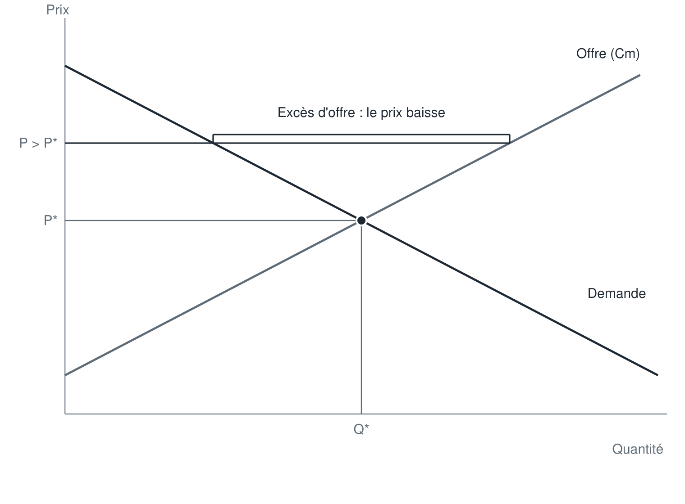

### 3.4 Propriétés de l'équilibre

- C'est le **signal-prix** $P^* = 2$ € qui incite chaque boulanger à produire la quantité de pain demandée.
- **Aucune organisation centralisée** ne dit à chaque boulanger et à chaque consommateur ce qu'il doit faire.
- À 2 €, le profit de chaque boulanger est positif : il dispose d'une **rente**.

## 4. Équilibre et bien-être

### 4.1 Le surplus à l'échange

- **Consommateurs** : les consommateurs « infra-marginaux » (PAP $> P^*$) étaient prêts à payer jusqu'à leur PAP mais ne paient que $P^*$ ; la différence est leur surplus. Graphiquement : l'aire entre la courbe de demande et le prix $P^*$.
- **Producteurs** : leur surplus (profit hors coûts fixes) est l'aire entre la droite horizontale $P^*$ et la courbe de coût marginal (l'offre).
- **Surplus à l'échange** : somme des deux.

Exemple graphique : avec $P^* = 8$ et $Q^* = 24$, le surplus des consommateurs est le triangle au-dessus de 8 sous la demande, celui des producteurs le triangle sous 8 au-dessus de l'offre.

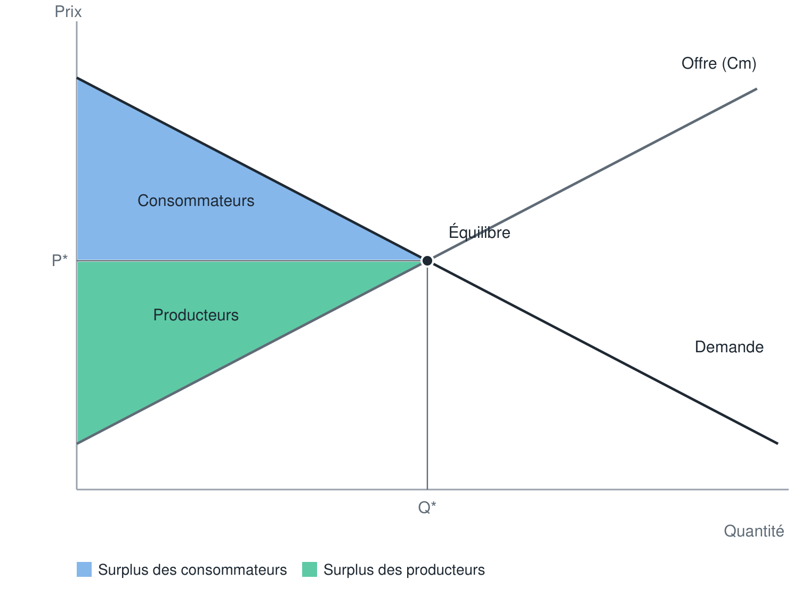

### 4.2 Le prix, signal de la valeur et du coût

À l'équilibre :

$$P^* = \text{coût marginal de la dernière unité produite} = \text{PAP de l'acheteur marginal}$$

Force du signal-prix :

- $P^* = Cm$ : les consommateurs sont incités à **internaliser le coût collectif** de leur consommation ;
- $P^* = $ PAP marginale : les producteurs sont incités à produire des choses **utiles** (que les consommateurs valorisent).

### 4.3 Le théorème de la main invisible

**L'équilibre concurrentiel maximise le surplus à l'échange** :

- il n'existe aucune paire consommateur-producteur qui pourrait trouver un avantage mutuel à un échange supplémentaire ;
- tous les échanges pour lesquels PAP $> Cm$ ont été exploités.

L'équilibre concurrentiel est donc **efficace** (optimum de Pareto) : on ne peut pas améliorer la situation d'un agent sans détériorer celle d'un autre.

### 4.4 La distribution du surplus

Efficace ne veut pas dire **désirable** : le surplus peut être très mal partagé entre producteurs et consommateurs.

Le partage dépend des **élasticités** de l'offre et de la demande : le surplus des consommateurs est plus fort si la courbe de demande est **plus pentue**, c'est-à-dire si l'élasticité de la demande est faible.

### 4.5 Effet d'une cartellisation : la perte sèche

Si les producteurs s'entendent et se comportent comme un monopole, ils produisent là où $Rm = Cm$ : la quantité baisse sous $Q^*$ et le prix monte au-dessus de $P^*$. Les échanges entre la quantité du monopole et $Q^*$ (où PAP $> Cm$) ne sont plus réalisés : c'est la **perte sèche**.

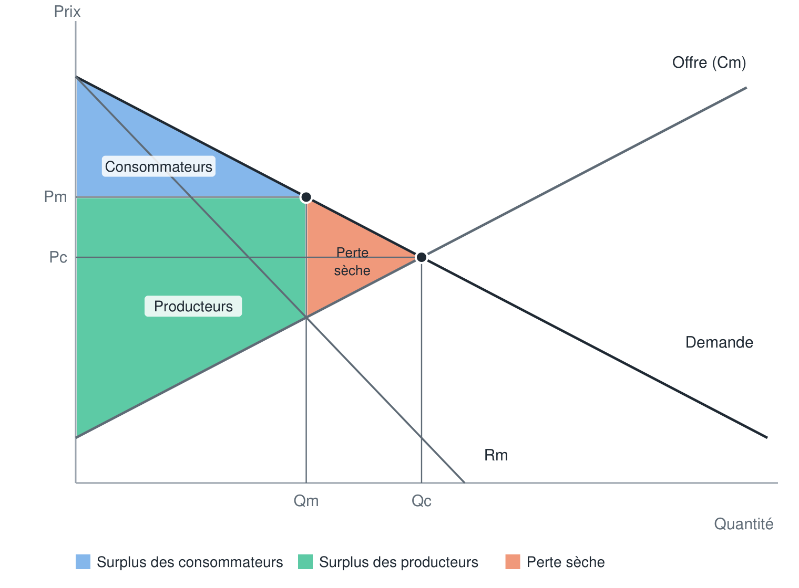

### 4.6 Monopole, duopole et concurrence

Sur un même marché, plus le degré de concurrence augmente :

- plus la **quantité** échangée augmente ;
- plus le **prix** diminue ;
- plus le **profit** de chaque entreprise diminue ;
- plus le **surplus des consommateurs** augmente, et plus le surplus des producteurs diminue.

| Exemple ($C(q) = q^2$, $P = 12 - Q$) | Monopole | Duopole | 10 entreprises en CPP |
|---|---|---|---|
| Quantité totale | 3 | 4,8 | 10 |
| Prix | 9 | 7,2 | 2 |
| Profit par entreprise | 18 | 11,5 | 1 |

```
Surplus des consommateurs : CPP > duopole > monopole
Surplus des producteurs   : monopole > duopole > CPP
```

## 5. Effet d'un choc sur la demande ou sur l'offre

### 5.1 Qu'est-ce qui fait bouger les prix ?

Sans choc sur l'offre ou la demande, le prix d'équilibre reste inchangé.

- La **demande** dépend de multiples facteurs : PIB, évolution du prix des autres biens, environnement, découverte des bienfaits de la consommation du bien…
- L'**offre** dépend aussi de multiples facteurs : prix des inputs, innovation technologique… La courbe d'offre rassemble les coûts marginaux de toutes les entreprises : si ces coûts changent, c'est toute la courbe qui bouge.

Un changement du **prix** ou de la **quantité** du bien lui-même fait seulement **se déplacer le long** des courbes ; un changement d'un **autre facteur** fait **déplacer les courbes**.

**Méthode pour analyser un choc sans se tromper :**

1. Le choc touche-t-il l'**offre** ou la **demande** ?
2. Est-il **positif** ou **négatif** ? Pour le savoir, on fixe un prix quelconque et on se demande si, à ce même prix, on demande (ou on offre) plus ou moins qu'avant.
3. On **déplace la courbe** concernée (vers la droite si positif, vers la gauche si négatif).
4. À l'ancien prix apparaît un **excès** (de demande ou d'offre) qui pousse le prix jusqu'au **nouvel équilibre**.

**Erreur fréquente** : face à une hausse de la demande, croire que l'offre augmente aussi « parce que les entreprises savent qu'elles vendront plus ». Les entreprises offrent effectivement plus, mais en **se déplaçant le long** de leur courbe d'offre (vers le haut à droite) : la fonction d'offre elle-même n'a pas changé.

### 5.2 Exemple 1 : un refroidissement et le prix du kWh (choc de demande)

Une vague de froid augmente la demande d'électricité : la courbe de demande se déplace vers la droite. À l'ancien prix, il y a un **excès de demande** ; le prix monte jusqu'au nouvel équilibre, avec un prix et une quantité plus élevés.

```
Froid → demande d'électricité ↑ → excès de demande à l'ancien prix → prix ↑ et quantité ↑
```

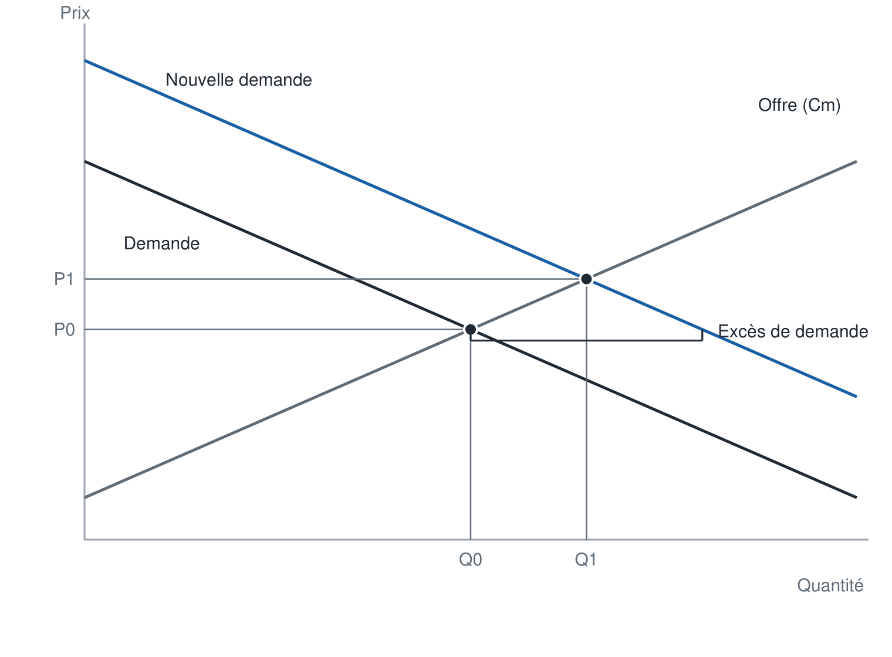

### 5.3 Exemple 2 : la baisse du prix du charbon et le prix de l'acier (choc d'offre)

Le charbon est un input de l'acier : sa baisse réduit le coût marginal des aciéries, et la courbe d'offre se déplace vers le bas (la droite). À l'ancien prix, il y a un **excès d'offre** ; le prix baisse jusqu'au nouvel équilibre, avec un prix plus bas et une quantité plus élevée.

```
Prix du charbon ↓ → Cm de l'acier ↓ → offre ↑ → excès d'offre à l'ancien prix → prix ↓ et quantité ↑
```

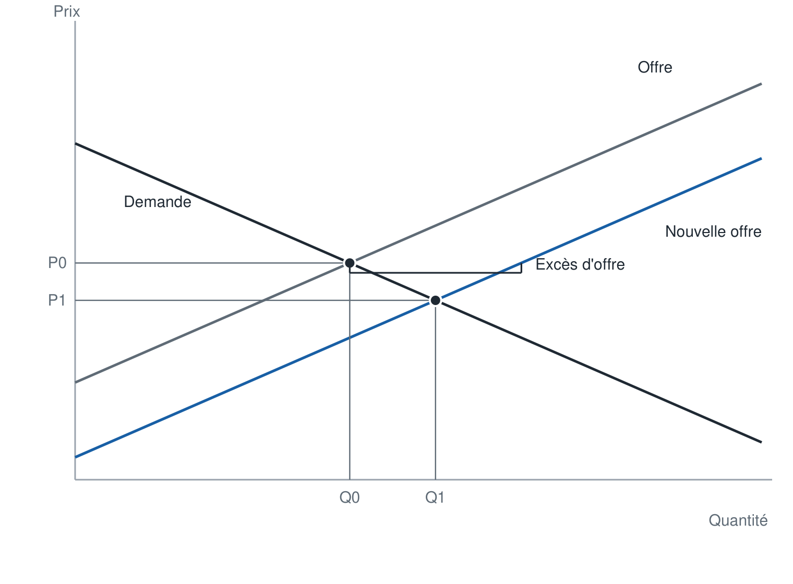

### 5.4 Biens substituts et biens compléments

- **Biens substituts** : quand le prix de l'un augmente, la demande de l'autre augmente (on remplace l'un par l'autre).
- **Biens compléments** : biens consommés ensemble ; quand le prix de l'un augmente, la demande de l'autre baisse.

**Le bœuf et le poulet (substituts)** : une hausse du prix du bœuf pousse les consommateurs vers le poulet (même apport en protéines). Choc **positif de demande** sur le marché du poulet : excès de demande à l'ancien prix, puis prix et quantité de poulet plus élevés.

```
Prix du bœuf ↑ → demande de poulet ↑ → excès de demande → prix du poulet ↑ et quantité ↑
```

**La voiture et l'essence (compléments)** : une hausse du prix des voitures réduit (à long terme) la demande d'essence. Choc **négatif de demande** sur le marché de l'essence : excès d'offre à l'ancien prix, puis prix et quantité d'essence plus bas.

### 5.5 Choc d'offre et choc de demande simultanés

**Exemple : hausse générale des salaires et marché automobile français.**

- **Choc d'offre négatif** : le travail, un input, devient plus cher ; les coûts des constructeurs français augmentent fortement → l'offre se déplace vers la gauche.
- **Choc de demande positif** : les ménages sont plus riches → la demande se déplace vers la droite, mais plus modestement (tout le monde ne rachète pas une voiture).

Résultat :

- le **prix augmente** sans ambiguïté (la demande part à droite, l'offre à gauche : le nouveau croisement est forcément plus haut) ;
- l'effet sur la **quantité est ambigu** : il dépend de la **taille de chaque choc** (une forte baisse de l'offre fait baisser la quantité, un fort choc de demande peut la faire monter) et des **élasticités** (pente des courbes).

Quand l'offre et la demande bougent en même temps, il faut donc plus d'informations (ampleur des déplacements, pentes) pour conclure.

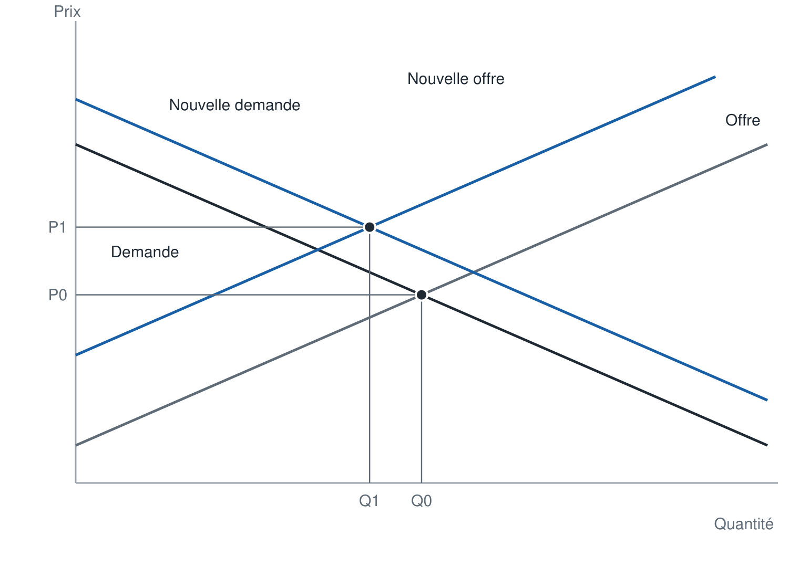

**Toujours penser au second effet** : une hausse des salaires vise à augmenter le pouvoir d'achat, mais elle augmente aussi les coûts des entreprises, donc les prix. Sur le marché des voitures **importées**, en revanche, l'offre n'est pas touchée et seule la demande augmente. Verser un chèque à chaque ménage éviterait le choc d'offre, mais il faut le financer par l'impôt : pris aux ménages, il leur retire le pouvoir d'achat redonné ; pris aux entreprises, il crée à nouveau un choc d'offre négatif.

Tout ceci suppose des marchés en concurrence pure et parfaite, ce qui n'est pas le cas dans la réalité : ces conclusions sont à manier avec prudence.

## 6. Effet d'une intervention sur le marché : prix plafond et prix plancher

### 6.1 Mesurer la variation du surplus social

Pour évaluer une politique publique, on mesure les gains et pertes de surplus des consommateurs et des producteurs. Exemple : un gouvernement interdit de vendre au-dessus d'un **prix plafond** inférieur au prix de marché.

Dès que l'État fixe le prix (prix plafond, prix plancher, quotas), on **sort de la concurrence pure et parfaite** : le prix ne s'établit plus librement sur le marché.

Comme l'équilibre concurrentiel est un optimum de Pareto (surplus global maximal), toute intervention qui l'écarte de son prix fait **baisser le surplus global**. La vraie question est alors : le groupe que la politique veut aider y gagne-t-il ?

**Rôle de l'économiste** : il ne décide pas à la place du responsable politique. Il chiffre qui gagne et qui perd (surplus des consommateurs, des producteurs, perte sèche) et explique les conséquences de chaque option ; l'élu tranche. On peut tout à fait accepter de perdre un peu d'**efficacité** pour gagner en **équité** : c'est un choix politique, à faire en connaissance de cause.

### 6.2 Le prix plafond

Avec un prix plafond $P_{max} < P_0$ : la quantité produite baisse ($Q_1$), la quantité demandée augmente ($Q_2$) : il y a **pénurie**.

- **Consommateurs** : ceux qui peuvent encore acheter paient moins cher et gagnent le rectangle **A** ; ceux qui ne peuvent plus acheter (rationnés) perdent le triangle **B**. Variation **ambiguë** : $A - B$.
- **Producteurs** : certains vendent moins et moins cher, d'autres quittent le marché : ils perdent **A + C**.
- **Perte sèche** pour la société : les triangles **B + C**.

| Acteur | Variation de surplus |
|---|---|
| Consommateurs | $+A - B$ (ambiguë) |
| Producteurs | $-A - C$ |
| Société | $-(B + C)$ : perte sèche |

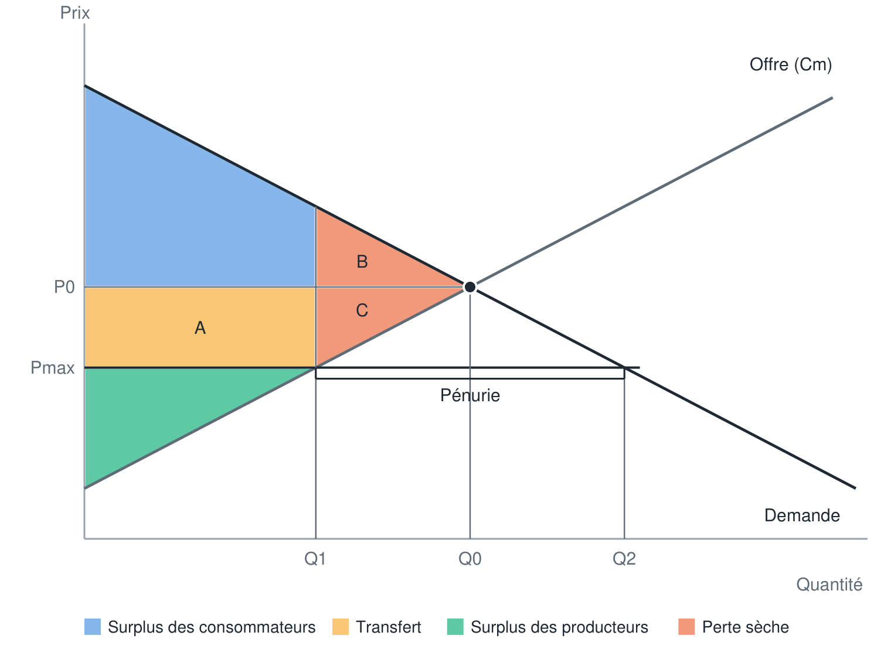

La perte des producteurs n'est jamais compensée par le gain (généralement positif) des consommateurs : la société subit une perte nette $B + C$ que personne ne récupère. Cette perte sèche mesure l'**inefficacité** du contrôle des prix.

**Demande inélastique** : si la demande est suffisamment inélastique, le triangle B peut être plus grand que le rectangle A : les consommateurs eux-mêmes subissent une perte nette. Avec une demande très pentue, les consommateurs privés du bien par la pénurie avaient des PAP très élevées (un étudiant prêt à payer 10 € un repas payé 3 € perd 7 € de surplus, quand celui qui était prêt à payer 3,10 € ne gagnait que 0,10 €) : leur perte l'emporte sur le gain de ceux qui achètent moins cher.

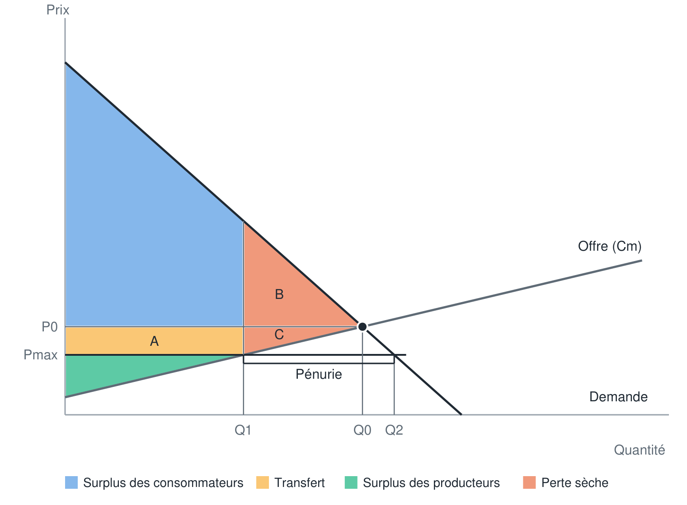

**Exemple : le repas au restaurant universitaire.** Le repas coûte 3 € ; l'État impose un prix plafond de 1 €.

- l'offre baisse (quantité $Q_O$) : les producteurs dont le coût marginal dépasse 1 € cessent de produire, car chaque repas vendu leur ferait perdre de l'argent ;
- la demande augmente (quantité $Q_D$) : des étudiants dont la PAP était comprise entre 1 et 3 € viennent désormais ;
- l'excès de demande se traduit par une **file d'attente**, égale à $Q_D - Q_O$ (et non à la différence entre l'ancienne quantité et $Q_O$) : les nouveaux venus, attirés par le prix bas, font aussi la queue. Exemple historique : lors du premier choc pétrolier, le prix plafond de l'essence a provoqué de longues files devant les stations-service.
- **rectangle A** : transfert des producteurs vers les consommateurs qui achètent toujours, à 1 € au lieu de 3 € ;
- **triangle B** : perte des consommateurs victimes de la pénurie (le « fond de la file », qui n'est pas servi) ;
- **triangle C** : perte des producteurs qui ont arrêté de produire.

Le surplus des consommateurs augmente si $A - B > 0$ ; si $A - B < 0$, tout le monde perd (consommateurs, producteurs, efficacité) et il vaut mieux abandonner la politique.

**Un prix plafond n'a d'effet que s'il est inférieur au prix d'équilibre.** Un plafond fixé au-dessus (100 € pour un repas à 3 €) ne change rien : pas de pénurie, simple effet d'annonce.

### 6.3 Exemple : le contrôle des loyers

- Le plafonnement des loyers est souvent invoqué pour redistribuer du pouvoir d'achat des **propriétaires vers les locataires**.
- Il faut tenir compte de ses effets redistributifs et pondérer **efficacité et solidarité** (quelle est notre aversion aux inégalités ?).
- Son efficacité dépend surtout de l'**offre** : c'est seulement si elle est très **inélastique** (offre fixe, comme peut-être en centre-ville) que l'effet peut être favorable — la quantité de logements ne baisse alors presque pas.
- C'est donc une **question empirique**.

Effets attendus : les locataires qui trouvent un logement paient moins cher (gain) ; les propriétaires perdent, qu'ils continuent à louer moins cher ou qu'ils retirent leur bien du marché (le loyer ne couvre plus leurs dépenses) ; certains locataires ne trouvent plus de logement (pénurie).

**Cas de l'offre parfaitement inélastique (centre-ville saturé)** : on ne peut plus construire, la quantité de logements offerte est la même quel que soit le loyer ; l'offre est **verticale**. Un plafond (500 € au lieu de 700 € pour un studio) ne réduit pas l'offre : il n'y a **pas de perte sèche**, seulement un **transfert** des propriétaires vers les locataires. Plus l'offre est verticale, plus le triangle de perte des consommateurs est petit. La quantité demandée augmente (de nouveaux candidats, comme des jeunes qui quittent le domicile parental), ce qui allonge les files aux visites, mais ces personnes n'avaient aucun surplus auparavant.

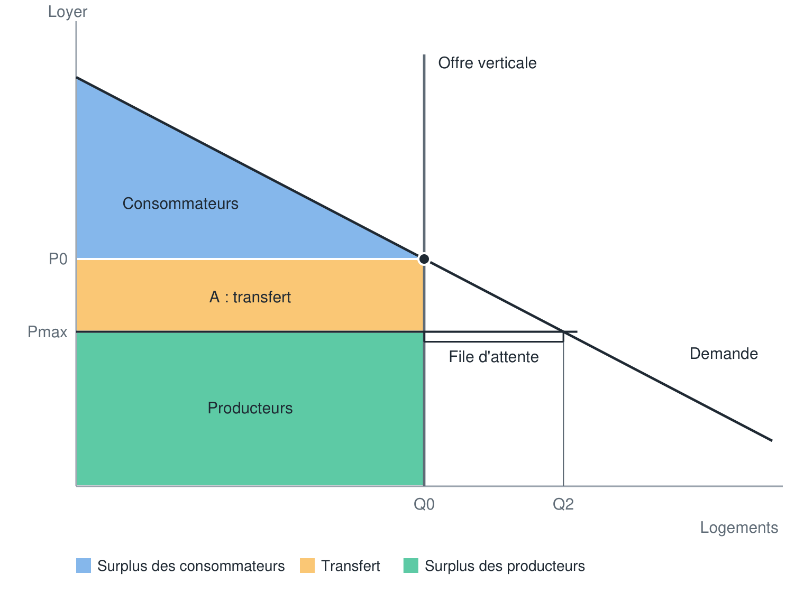

La demande de logement n'est pas parfaitement inélastique pour autant : on peut habiter plus loin ou chez ses parents.

Un prix plafond ne cible pas les personnes dans le besoin : tous les acheteurs en bénéficient, quelle que soit leur richesse (la discrimination par les prix étant interdite).

### 6.4 Le prix plancher

Avec un prix plancher $P_{min} > P_0$ : la quantité achetée baisse ($Q_1$).

- **Consommateurs** : ils perdent **A + B** — A correspond à la hausse du prix sur la quantité toujours achetée, B à la quantité qui n'est plus achetée.
- **Producteurs** : ils gagnent **A − C** — A grâce au prix plus élevé sur la quantité toujours vendue, C perdu sur la quantité qui n'est plus vendue.
- **Perte sèche** : **B + C**.

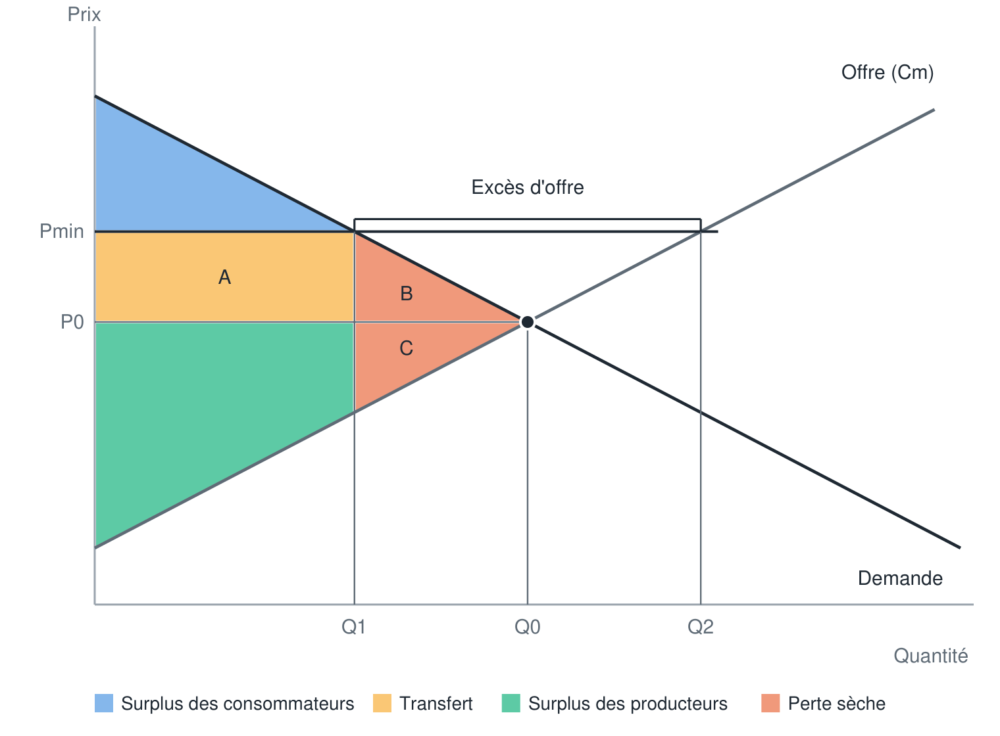

La perte sèche (triangles B et C) est une bonne estimation de la perte d'efficacité des politiques qui imposent un prix supérieur au prix d'équilibre ; on la mesure en calculant l'aire des deux triangles.

### 6.5 Exemple : le salaire minimum

Sur le marché du travail, les travailleurs offrent leur travail et les entreprises le demandent.

- Le salaire minimum $w_{min}$ est fixé au-dessus du salaire d'équilibre $w_0$.
- La demande de travail des entreprises baisse ($L_1$) alors que l'offre augmente ($L_2$) : il en résulte un **chômage** de $L_2 - L_1$.
- Les travailleurs qui gardent leur emploi gagnent un salaire plus élevé (gain **A**).
- La perte sèche est donnée par les triangles **B** et **C**.

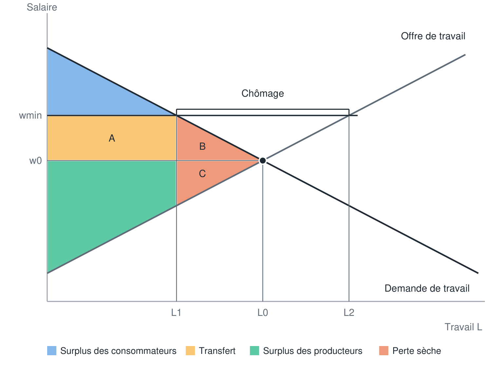

## 7. Ce qu'il faut retenir

- La concurrence élimine le pouvoir de marché : chaque acteur prend le prix comme donné.
- **Loi du prix unique** : si le marché fonctionne bien, un seul prix se forme.
- À l'équilibre, **offre = demande**.
- À l'équilibre, **$P^* = $ coût marginal**.
- L'équilibre concurrentiel est **Pareto-efficace**, mais pas nécessairement désirable.
- L'équilibre est modifié par des **chocs** sur les paramètres qui influencent l'offre ou la demande.
- Les interventions modifiant le prix d'équilibre sont susceptibles de générer une **perte d'efficacité** (perte sèche).

<!-- SOURCES INTÉGRÉES
- Chapitre 4 - CPP - Simulation Salle de Marché ✅.pdf
- Chapitre 4 - Léquilibre concurrentiel 2023 Gollier ✅.pdf
- Chapitre 4 -Egalisation des Cm - Minimisation du coût total ✅.pdf
- Exemple Monopole duopole concurrence Gollier ✅.pdf
- CC2 - Correction Succincte ✅.pdf
- Micro 11-transcript-DRAFT ✅.txt
- Micro 12-transcript-DRAFT ✅.txt
-->
